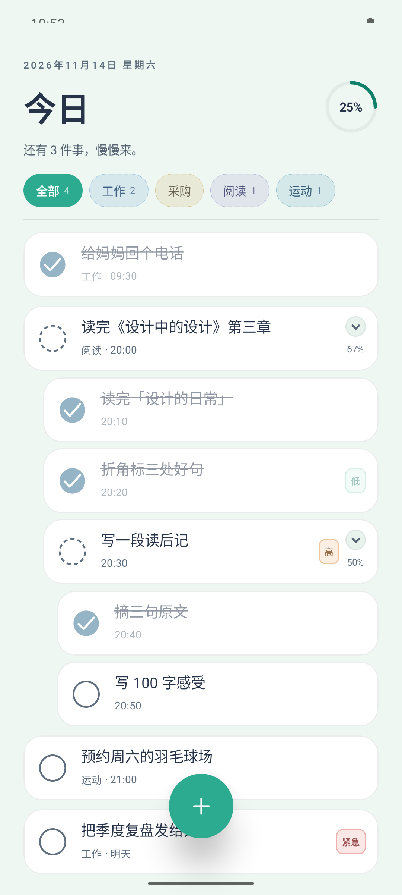
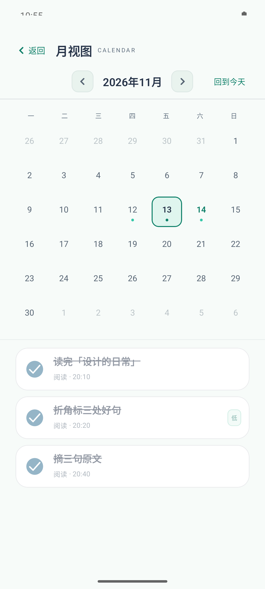
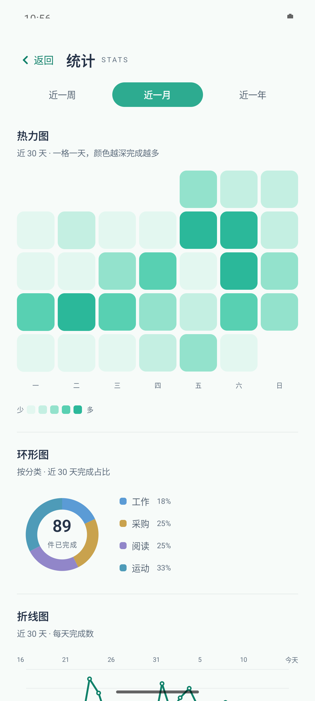
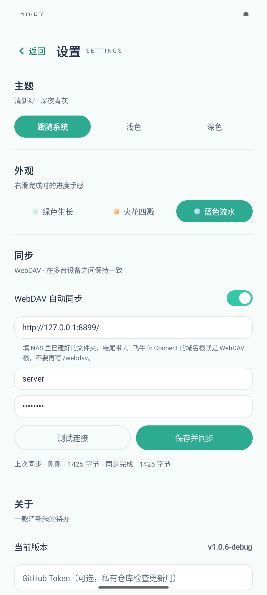
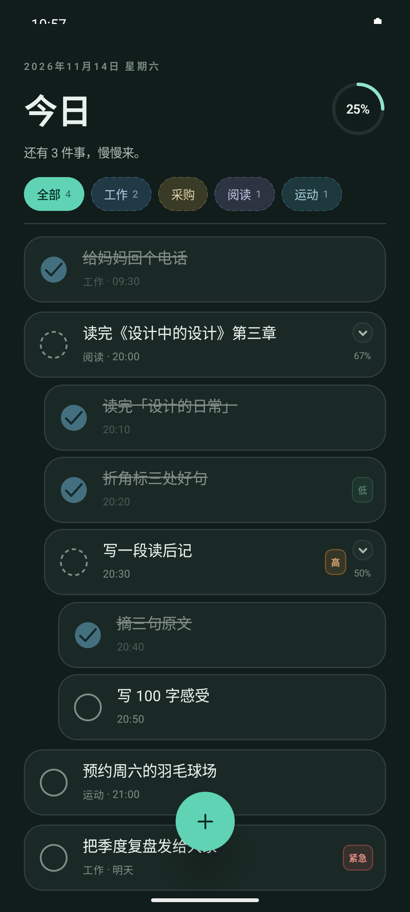
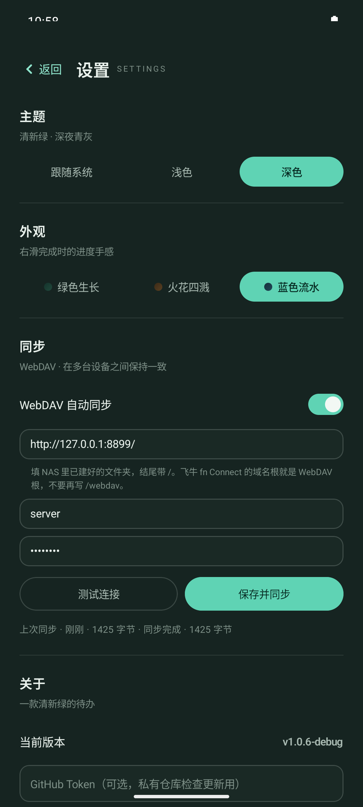

# doit

一款清新薄荷绿的待办应用，Kotlin + Jetpack Compose 原生实现，浅色清新绿 / 深色深夜青灰两套主题实时切换，支持 WebDAV 双向同步与月视图归档。

主要能力：

- **首页「今日待办」**：只展示未被整体完成、以及今天刚完成的顶级任务；整体完成且完成日期不是今天的自动归档进月视图；右上角进度环显示今日完成度。
- **右滑完成**：进度从卡片左端跟手生长，滑到 55% 松开即完成，勾选圈同步描出对勾。
- **左滑操作**：露出 优先级 / 分类 / 子任务 / 删除；已完成的任务左滑只露出 删除。
- **子任务无限下拆**：子任务全做完，父任务自动整体完成（逐级向上冒泡）。
- **编辑规则分级**：父任务编辑可改标题与分类、子任务只改标题与优先级、已完成任务不提供编辑；单条左滑换颜色 / 删除，分类可随时增删改色。
- **分类管理**：自定义分类胶囊 + 颜色，删除分类不影响待办（仅变回未分类）。
- **云同步按钮**：开启 WebDAV 并连通后显示在顶部，与远程一致显示绿勾云、有未同步改动显示警示云（橙箭头），点击即手动同步。
- **月视图**：按完成日期聚合成日历，有完成记录的日子打小圆点，选中某天查看当天完成项。
- **统计页**：热力图（周 / 月 / 年）、环形图、折线图，三段时间范围联动。
- **WebDAV 双向同步**：在多个设备之间保持一致，双向三方合并，本地改动优先、不丢远程记录。
- **检查更新**：连接 GitHub Releases 比对最新版本，发现新版后应用内直接下载 APK（带进度条）并自动调起安装器。公开仓库无需任何凭据。

物料索引：

- 源码仓库：<https://github.com/nabaonan/doit-apk>（只有打 `v*` tag 才触发 CI 构建）
- 功能截图：`screenshots/`（各页面亮 / 暗主题对比）

---

## 功能截图

应用主页面（亮色主题，模拟器 1080×2400）：

| 今日待办 | 月视图（选中某天看完成项） | 统计·热力图 | 设置 |
| --- | --- | --- | --- |
|  |  |  |  |

亮 / 暗主题切换对比（设置页「主题」可随时切换）：

| 亮色主题 | 深色主题 |
| --- | --- |
|  |  |
| 设置页（亮） | 设置页（深） |
|  |  |

深色是一套独立调色板（深夜青灰 `#111D1B` 底 + 薄荷绿 `#79C9A0`），不是对浅色简单反色；状态栏/导航栏图标会一起反色。

---

## 快速开始

### 环境要求

| 项 | 版本 | 说明 |
| --- | --- | --- |
| JDK | 17 | 构建必需 |
| Android SDK | compileSdk **35**，minSdk **26**，targetSdk **35** | 需要 `platforms;android-35` 与 `build-tools;35.0.0` |
| Gradle | 8.11.1 | wrapper 的 `distributionUrl` 指向腾讯镜像；CI 直接用官方发行版 |
| Android Studio | 任意较新版本 | 可选，命令行即可构建 |

### 构建与运行

```bash
# 单元测试（任务树 / 统计序列 / 地址校验 / 双向合并 / 更新检查）
./gradlew testDebugUnitTest

# Lint 静态检查
./gradlew lintDebug

# 构建调试包（模拟器 / 真机调试用）
./gradlew assembleDebug

# 构建正式包（用 keystore.properties / 环境变量里的签名密钥；无密钥则回退 debug 签名并警告）
./gradlew assembleRelease

# 装到已连接的设备
adb install -r doit/build/outputs/apk/debug/doit-<版本>-debug.apk
```

产物统一命名 `doit-<versionName>-<buildType>.apk`，例如 `doit-1.0.6-debug.apk`。

要点：

- **调试包**包名 `com.doit.app.debug`，桌面显示「doit · 调试」，可与正式包共存；自带六条示例待办 + 一年演示完成记录，方便核对卡片形态与统计页。
- **正式包**包名 `com.doit.app`，零预置数据（连默认分类都不建），首次打开是空白清单。
- **版本号不用手改**：`doit/build.gradle.kts` 从最近的 git tag 推导（`v1.2.3` → `versionName=1.2.3`、`versionCode=10203 = major*10000 + minor*100 + patch`）；无 tag 时回退 `1.0.0 / 10000`，保证任何机器都能出包。

> 国内构建提速：仓库里的 `settings.gradle.kts` 在本机走阿里云镜像（CI 环境 `CI=true` 时只用官方仓库，避免境外访问阿里云镜像返回 502）。若本地网络访问镜像不稳定，可去掉镜像配置。

---

## 发版

### 一键发版脚本 `./release.sh`

在仓库根目录运行，自动推算下一个版本号 → 打 tag → 推送，触发 CI 构建并发布 GitHub Release：

```bash
./release.sh            # 补丁版 +0.0.1：v1.0.6 → v1.0.7（默认）
./release.sh patch      # 同上，显式指定补丁版
./release.sh minor      # 次版本 +0.1.0：v1.0.7 → v1.1.0
./release.sh major      # 主版本 +1.0.0：v1.1.0 → v2.0.0
./release.sh 1.2.3      # 直接指定版本号
./release.sh --dry-run  # 只打印将打的版本，不做任何操作
```

脚本会做前置检查：工作区有未提交改动会中止（`--force` 可跳过）；本地/远端已存在同名 tag 会中止。发布后到 <https://github.com/nabaonan/doit-apk/actions> 查看构建进度。

### 打包与发布流程

1. 本地验证：`./gradlew testDebugUnitTest assembleRelease` 全绿。
2. `git commit` + `git push origin main`（普通推送不会触发 CI）。
3. `./release.sh` 打 `vX.Y.Z` tag 并推送 → GitHub Actions 自动执行：
   - `build` job：单测 → Lint → `assembleDebug`（上传 artifact）。
   - `release` job（仅 tag 触发）：`assembleRelease` → 以 `doit-<tag>-release.apk` 挂到 GitHub Releases。
4. 应用内「设置 → 检查更新」即可发现新版本并直接下载安装（公开仓库匿名即可，无需任何凭据）。

### 签名

- 签名材料**不入仓库**（签名密钥属于机密）。来源优先级：
  1. 本地 `keystore.properties`（项目根 或 `~/.doit-keystore/keystore.properties`，两者都已 gitignore）
  2. 环境变量 `DOIT_KEYSTORE(_PASSWORD)` / `DOIT_KEY_ALIAS` / `DOIT_KEY_PASSWORD`（CI 的 GitHub Secrets 会注入为同名环境变量）
- CI 的 `release` job 从仓库 Secrets 恢复密钥：在 **Settings → Secrets and variables → Actions** 添加：
  - `KEYSTORE_BASE64`（keystore 文件的 base64）
  - `KEYSTORE_PASSWORD` / `KEY_ALIAS` / `KEY_PASSWORD`
- 无密钥时构建会回退用 debug 证书签名并打印警告（仅本地临时出包，不可覆盖升级）。
- 生成一把新证书：

```bash
keytool -genkeypair -v -keystore doit-release.jks \
  -alias doit -keyalg RSA -keysize 2048 -validity 36500 \
  -storepass '换成你自己的强口令' -keypass '同样的强口令' -dname "CN=Doit, O=Doit, C=CN"
# base64 后放入 GitHub Secret：`base64 -w0 doit-release.jks`
```

---

## 技术栈

- Kotlin 2.0.21 · Jetpack Compose（BOM 2024.12.01）· Material 3
- Room 2.6.1（KSP）本地持久化，离线优先；DataStore Preferences 存设置
- 手势：`pointerInput + awaitEachGesture` 自绘双向滑动，未用第三方库
- WebDAV：`HttpURLConnection`（探针 PUT 探活 / GET 下载 / PUT 备份 / DELETE 清理），快照编解码用系统 `org.json`
- 更新检查与应用内更新：`HttpURLConnection` 拉取 GitHub Releases API + 语义版本比较（`update/UpdateChecker.kt`），流式下载 APK（`update/ApkDownloader.kt`，带进度），FileProvider 调起安装器
- 单元测试：纯 JVM 测试（JUnit4），覆盖任务树 / 统计序列 / 地址校验 / 同步合并 / 更新检查

---

## 目录结构

```
Doit/
├── doit/src/main/java/com/doit/app/
│   ├── MainActivity.kt           # 边到边 + 主题配置
│   ├── data/                     # Room 实体 / DAO / 仓库 / 种子数据
│   ├── sync/                     # WebDAV 同步
│   │   ├── WebDavClient.kt       #   探活 / 下载 / 上传（405 自动纠错）
│   │   ├── SyncModels.kt         #   快照模型（纯 Kotlin）
│   │   ├── SyncMerge.kt          #   双向三方合并 + 内容指纹
│   │   ├── SnapshotCodec.kt      #   v2 编解码，兼容 v1 旧备份
│   │   ├── SyncEngine.kt         #   同步编排与状态落盘
│   │   └── DavUrl.kt             #   地址格式校验
│   ├── update/                   # 更新检查与应用内下载安装
│   │   ├── UpdateChecker.kt      #   GitHub Releases 检查（语义版本比较）
│   │   └── ApkDownloader.kt      #   流式下载 APK（带进度回调）
│   └── ui/
│       ├── MainScreen.kt         # 今日清单 + 页面切换 + 提示条
│       ├── MainViewModel.kt      # UiState / 面板 / 动作 / 应用内更新状态
│       ├── StatsPage.kt          # 热力图 / 环形图 / 折线图
│       ├── CalendarPage.kt       # 月视图（按完成日期聚合）
│       ├── SettingsPage.kt       # 外观 / 同步 / 关于（含更新下载进度条）
│       ├── DoitIcon.kt              # 24×24 网格手绘线性图标
│       ├── gesture/SwipeState.kt # 双向滑动与上膛判定
│       ├── components/           # 卡片 / 勾选 / 面板 / FAB 卫星
│       └── theme/                # 设计令牌（配色、字体、皮肤）
├── .github/workflows/android.yml # CI：只在 tag 触发
├── screenshots/                  # 功能截图（亮 / 暗主题）
└── release.sh                    # 一键发版脚本
```

---

## 关键设计

### 首页「今日待办」口径

只按**顶级任务**过滤，子任务不单独过滤（凡展示的顶级任务，其全部子任务——含已完成与未完成——都完整带出）：

- **展示**：顶级任务未整体完成；或整体完成但完成日期是**今天**。
- **移除**：整体完成（顶级 + 全部子任务都做完）且 `completedAt` 不是今天的顶级任务，自动归档进月视图；完成时间缺失 / 异常的也按非今日处理。
- 右上角进度环恒按「今日全部」统计（分母含已完成与未完成，分子是今日完成的），与分类标签解耦；副标题「还有 N 件事」按当前可见列表。

完成判定：父任务子任务全做完即自动整体完成（`recalcUp` 逐级冒泡），顶级任务的 `completedAt` 决定其“完成日期”（跨天子任务以最后一次完成时间为准）。

### WebDAV 双向同步

- **数据模型**（Room v1 → v2）：`uid`（跨设备稳定）、`updatedAt`（每次编辑刷新）、`deletedAt`（删除墓碑，删除可被同步）；老数据启动时 `ensureSyncMeta()` 幂等补齐。
- **合并是并集，不是替换**：只在单边出现的记录一律保留；有 `base` 时字段级三方合并；同字段两边都改按“删除 > 编辑 > 完成 > 创建”取时间新的一方，时间相同则远程优先；本机相对 base 改过、远程与 base 一致 → **整条以本机为准**（本地改动硬保证，不被远程旧副本覆盖）。
- 远程旧副本防护：`isStaleRemote()` 依据 schemaVersion / revision / exportedAt 识别旧文件，命中则用 base 顶替并强制重新发布。
- 相关单测 27 个，覆盖本地改动优先、无时间戳记录删除、旧副本识别 / 强制发布、base 兜底等分支。

### 主题与设计令牌

- 所有颜色走 `Doit` 令牌（`DoitPalette`），两套：浅色 `Mint`（浅薄荷绿底 + 纯白卡片 + `#34C7A8`）、深色 `Midnight`（深夜青灰 `#111D1B` + 薄荷绿 `#79C9A0`）；设置页「主题」三档（跟随系统 / 浅色 / 深色）。
- 三套进度皮肤（绿色生长 / 火花四溅 / 蓝色流水）各自有浅深两版填充。
- 三类语义色例外不随主题变：`FlowSkin` 皮肤、`Priority` 五档优先级色、分类颜色（存在用户数据里）。

### 检查更新

- `update/UpdateChecker.kt` 请求 `api.github.com/repos/nabaonan/doit-apk/releases/latest`，语义版本比较，提示「发现新版本 vX」或「已是最新」。
- 发现新版后可应用内直接下载（`update/ApkDownloader.kt`，带进度条）并调起系统安装器（FileProvider + `REQUEST_INSTALL_PACKAGES`）。
- 仓库公开后匿名即可访问，**无需任何 Token**，设置里也不再提供 Token 输入框。

---

## 更新记录

| 版本 / 轮次 | 内容 |
| --- | --- |
| **v1.0.13** | 检查更新发现新版后**应用内直接下载 APK（带进度条）+ 自动调起安装器**；移除 GitHub Token 输入框（仓库公开后匿名即可检查） |
| v1.0.12 | 检查更新网络断连自动重试、云按钮加大到与进度环同尺寸并重绘图标、进度环轨道加深可见、Token 即时生效 |
| v1.0.11 | 检查更新提示区分「未填 Token / Token 权限不足」 |
| v1.0.10 | 编辑分类保存后关闭弹框提示成功；云同步按钮区分一致（绿勾云）/不一致（警示云） |
| v1.0.9 | 检查更新日程改为「连通性测试通过才显示云同步按钮」（持久化 davVerified） |
| v1.0.8 | 任务编辑功能上线：父/子/已完成三级编辑规则（子任务不可改分类、已完成无编辑入口） |
| v1.0.7 | 全面统一命名为 doit（彻底移除 quandian 旧名）；README 重构；release 统一签名 |
| v1.0.6 | 检查更新真正联网比对 GitHub Release（新增可选 Token） |
| v1.0.5 | 首页今日待办过滤（只留活跃项 + 今日完成项）；月视图页面 + 已完成待办侧滑删除 |
| v1.0.4 | 同步后本地改动不再被远程覆盖（本地优先 + 旧副本防护 + base 兜底） |
| v1.0.3 | WebDAV 双向同步：Room v1→v2 补 uid/updatedAt/deletedAt，并集合并非替换 |
| v1.0.2 | WebDAV 405 根治：改 PUT 探针探活 + 自动找可用目录 + 按场景翻译错误 |
| v1.0.1 | 一键发版脚本 `release.sh` + WebDAV 405 诊断优化 |
| 1.6→1.7 轮 | 同步开关门控 + 地址校验标红；去默认分类（正式包零内置数据）；优先级换色（普通蓝/高橘/紧急红）；动作按钮等距 |
| 1.4→1.5 轮 | 点卡不勾选 + 进度环随手退；卡片排版统一（子任务同尺寸）+ 展开收起；删除线单条、百分比统一 |
| 主题轮 | 暖调配色 → 降饱和鼠尾草绿 → 提对比 → 夜间模式 → 主色提亮（Mint）+ 分类胶囊 + 切换动效 |
| 交互轮 | 分类胶囊统一组件、长按 FAB 卫星只留图标、返回手势不退出应用、气泡对齐、全新列表回顶等 |

每轮完整细则此前按「已实现的设计细节 / 各轮表格」维护在历史版本中；当前以本文档为准。

---

## 交付物

```
screenshots/              # 功能截图：home/calendar/stats/settings 与 *_light/*_dark 主题对比
doit/build/outputs/apk/   # 构建产物（debug / release，按版本命名）
```

Release 安装包由 GitHub Actions 在打 tag 后自动构建并发布，见 <https://github.com/nabaonan/doit-apk/releases>。
